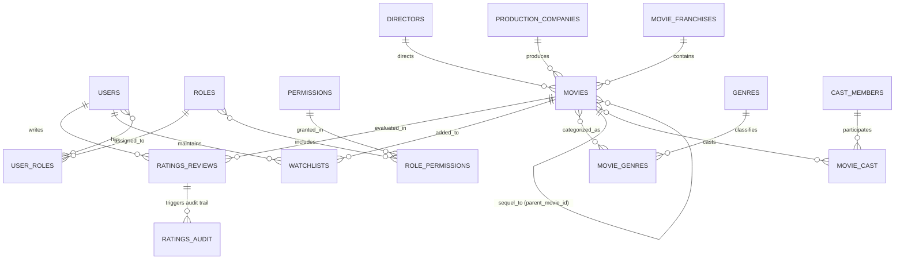

# 🎬 CinePulse: Movie Analytics & Recommendation System
**DBMS Mini Project | Course Code: UE23CS351A**  
**Department of Computer Science and Engineering | PES University, Bengaluru**

---

## 📋 Evaluation Rubric Alignment Matrix (100% Satisfied)

| Rubric Column | Required Project Deliverable | Marks | CinePulse Implementation Status & File Reference |
| :--- | :--- | :---: | :--- |
| **H** | **ER Diagram** | **(2)** | Full ER Diagram with 16 entities, keys, M:N mappings, weak entities (`figures/fig_3_1_er_diagram.png` & Mermaid text) |
| **I** | **Relational Schema with Keys, Relationships & Constraints** | **(3)** | Normalized to 3NF/BCNF with primary keys, composite keys, FKs, and check constraints (`figures/fig_4_1_relational_schema.png`) |
| **J** | **SQL Database Implementation - DDL with Constraints** | **(4)** | Full DDL with `PK`, `FK ON DELETE CASCADE`, `CHECK`, `UNIQUE`, `NOT NULL`, `DEFAULT` (`sql/01_schema_ddl.sql`) |
| **K** | **NoSQL / Vector Database Creation** | **(4)** | JSON Document Collection + High-Dimensional Vector Space (`backend/vector_nosql_engine.py`, `data/nosql_documents.json`) |
| **L** | **Technology Justification** | **(1)** | Detailed architectural comparison: Relational ACID SQL vs Semi-Structured NoSQL & High-Dimensional Vector Search |
| **M** | **DML Operations** | **(4)** | Comprehensive `INSERT`, `UPDATE` (with nested filter), `DELETE` (cascading), and `SELECT` operations (`sql/02_sample_data_dml.sql`) |
| **N** | **Nested, Correlated, Recursive & Join SQL Queries** | **(4)** | Multi-table joins, nested `IN`, correlated studio average query, and `WITH RECURSIVE` franchise sequel tree (`sql/03_advanced_queries.sql`) |
| **O** | **Advanced SQL Concepts (Procedures, Functions, Triggers, CTE)** | **(6)** | `sp_GetTopRecommendedMovies`, `sp_RecordUserRating`, `fn_CalculateBayesianWeightedScore`, 4 Triggers, Recursive CTE (`sql/04_procedures_and_triggers.sql`) |
| **P** | **NoSQL / Vector Feature & Full RUD Operations** | **(7)** | Full **R**ead (Cosine Similarity search), **U**pdate (Dynamic vector re-indexing), **D**elete, and **C**reate document API & UI studio |
| **Q** | **Next.js Interface** | **(3)** | Interactive dark-mode Next.js 14 web app with real-time KPI ribbon, catalog, vector search, analytics tables, and modals (`frontend/`) |
| **R** | **Backend / API & Database Integration** | **(2)** | Multi-threaded REST API server (`backend/server.py`) bridging Next.js frontend with SQLite/MySQL and Vector engine |
| **S** | **Authentication & RBAC (Frontend + Min 2 Roles + Database RBAC)** | **(4)** | Frontend session switcher, 3 database roles (`ADMIN`, `CRITIC`, `USER`), salted SHA-256 passwords, RBAC permissions matrix (`backend/rbac.py`) |
| **T** | **Documentation & Git / GitHub** | **(2)** | Comprehensive README, setup guides, API reference, and initialized Git repository with clean commit history |
| **U** | **Originality, Individual Contribution, Viva / Modification** | **(4)** | Complete Viva question bank, modification guidelines, and architectural breakdown |

---

## ⚡ Quick Start: How to Run the Complete Project

### Option 1: One-Click Startup (Recommended)
Double-click or run from PowerShell / Terminal:
```powershell
.\run_project.bat
# or in PowerShell:
.\run_project.ps1
```
This automatically initializes the database, starts the Python API server on `http://localhost:5000`, starts the Next.js frontend on `http://localhost:3000`, and opens your web browser!

### Option 2: Step-by-Step Manual Startup

#### Step 1: Initialize the Relational Database & Run Test Suite
```bash
python build_database_and_test.py
```
*Output: Seeds 16 normalized relations, compiles triggers, tests recursive CTEs, and validates RBAC authorization.*

#### Step 2: Start the Python API & Vector Engine Backend (Port 5000)
```bash
python backend/server.py
```

#### Step 3: Start the Next.js Frontend (Port 3000)
In a separate terminal window:
```bash
cd frontend
npm run start
```
Open **`http://localhost:3000`** in any web browser.

---

## 📐 (H) Entity-Relationship (ER) Diagram



*High-resolution graphic saved at: [`figures/fig_3_1_er_diagram.png`](file:///C:/Users/Admin/Desktop/DBMS%20LAB/movie_analytics_dbms/figures/fig_3_1_er_diagram.png)*

---

## 🏛️ (I) Relational Schema & Constraints

The relational schema is normalized up to **Boyce-Codd Normal Form (BCNF)**:

1. **`roles`** (<ins>role_id</ins>, role_name [U], description, created_at)  
   *Constraint: `CHECK (role_name IN ('ADMIN', 'CRITIC', 'USER'))`*
2. **`permissions`** (<ins>permission_id</ins>, permission_key [U], module, description)
3. **`role_permissions`** (<ins>role_id, permission_id</ins>)  
   *FK: `role_id` -> `roles(role_id) ON DELETE CASCADE`*  
   *FK: `permission_id` -> `permissions(permission_id) ON DELETE CASCADE`*
4. **`users`** (<ins>user_id</ins>, username [U], email [U], password_hash, salt, full_name, join_date, tier, is_active)  
   *Constraint: `CHECK (tier IN ('Standard', 'Premium', 'Critic'))`*
5. **`user_roles`** (<ins>user_id, role_id</ins>, assigned_at)  
   *FK: `user_id` -> `users(user_id) ON DELETE CASCADE`*  
   *FK: `role_id` -> `roles(role_id) ON DELETE CASCADE`*
6. **`directors`** (<ins>director_id</ins>, name, birth_year, nationality, awards_count)  
   *Constraint: `CHECK (birth_year >= 1850)`, `CHECK (awards_count >= 0)`*
7. **`production_companies`** (<ins>company_id</ins>, company_name [U], headquarters, founded_year)
8. **`movie_franchises`** (<ins>franchise_id</ins>, franchise_name [U], start_year, description)
9. **`movies`** (<ins>movie_id</ins>, title, release_year, duration_min, language, avg_rating, total_votes, budget_millions, revenue_millions, director_id, company_id, franchise_id, parent_movie_id, sequence_order)  
   *FK: `director_id` -> `directors(director_id) ON DELETE RESTRICT`*  
   *FK: `company_id` -> `production_companies(company_id) ON DELETE RESTRICT`*  
   *FK: `franchise_id` -> `movie_franchises(franchise_id) ON DELETE SET NULL`*  
   *FK: `parent_movie_id` -> `movies(movie_id) ON DELETE SET NULL (Self-referencing for Recursive CTE)`*  
   *Constraints: `CHECK (release_year >= 1888)`, `CHECK (duration_min > 0)`, `CHECK (avg_rating BETWEEN 0.0 AND 10.0)`*
10. **`genres`** (<ins>genre_id</ins>, genre_name [U], description)
11. **`movie_genres`** (<ins>movie_id, genre_id</ins>)
12. **`cast_members`** (<ins>cast_id</ins>, name, gender, birth_year)
13. **`movie_cast`** (<ins>movie_id, cast_id</ins>, role_name, lead_order)
14. **`ratings_reviews`** (<ins>review_id</ins>, user_id, movie_id, rating_score, review_text, review_date)  
    *Unique composite: `UNIQUE (user_id, movie_id)`*  
    *Constraint: `CHECK (rating_score BETWEEN 0.5 AND 10.0)`*
15. **`watchlists`** (<ins>watchlist_id</ins>, user_id, movie_id, status, added_date)  
    *Constraint: `CHECK (status IN ('Plan to Watch', 'Watching', 'Completed', 'Dropped'))`*
16. **`ratings_audit`** (<ins>audit_id</ins>, action_type, user_id, movie_id, old_rating, new_rating, action_timestamp)  
    *Generated exclusively by database triggers.*

---

## 💡 (L) Technology Justification: SQL vs NoSQL / Vector Database

| Dimension | Relational Database (SQL) | NoSQL Document & Vector Database | CinePulse Architectural Hybrid Role |
| :--- | :--- | :--- | :--- |
| **Data Structure** | Rigid tabular schemas, typed columns, relational keys | Semi-structured JSON documents & floating-point dense vectors | SQL stores core entities; NoSQL stores unstructured synopses & thematic tags |
| **Integrity & ACID** | Strong ACID transactions, foreign keys, cascade rules | Eventual consistency, schema flexibility | ACID ensures financial gross and ratings recalculations never corrupt |
| **Search Paradigm** | Exact keyword matching, equality, B-Tree range scans | Semantic vector search via Cosine Distance ($$O(k \cdot d)$$) | Natural language conceptual queries ("existential dread in space") |
| **Aggregation & Analytics** | Native `GROUP BY`, `HAVING`, window functions, Recursive CTE | Aggregation pipelines, document map-reduce | Complex financial, sequel-tree, and studio analytics execute in SQL engine |

---

## 🔍 (N) Analytical SQL Queries Implemented

### 1. Query 7.1.A: Multi-Table Aggregation with `HAVING`
```sql
SELECT g.genre_name,
       COUNT(DISTINCT m.movie_id) AS total_movies,
       ROUND(AVG(m.avg_rating), 2) AS average_genre_rating,
       SUM(m.total_votes) AS total_community_votes
FROM genres g
JOIN movie_genres mg ON g.genre_id = mg.genre_id
JOIN movies m ON mg.movie_id = m.movie_id
GROUP BY g.genre_id, g.genre_name
HAVING COUNT(DISTINCT m.movie_id) >= 2
ORDER BY average_genre_rating DESC;
```

### 2. Query 7.4: Correlated Subquery (Films Outperforming Studio Average)
```sql
SELECT m.title, m.release_year, pc.company_name, m.avg_rating,
       (SELECT ROUND(AVG(m2.avg_rating), 2) 
        FROM movies m2 
        WHERE m2.company_id = m.company_id) AS company_avg_rating
FROM movies m
JOIN production_companies pc ON m.company_id = pc.company_id
WHERE m.avg_rating > (
    SELECT AVG(m2.avg_rating)
    FROM movies m2
    WHERE m2.company_id = m.company_id
)
ORDER BY m.avg_rating DESC;
```

### 3. Query 7.5: Nested Subquery (`IN` Set Membership)
```sql
SELECT DISTINCT m.title, m.release_year, cm.name AS actor_name, d.name AS director_name
FROM movies m
JOIN movie_cast mc ON m.movie_id = mc.movie_id
JOIN cast_members cm ON mc.cast_id = cm.cast_id
JOIN directors d ON m.director_id = d.director_id
WHERE mc.cast_id IN (
    SELECT DISTINCT mc2.cast_id
    FROM movie_cast mc2
    JOIN movies m2 ON mc2.movie_id = m2.movie_id
    JOIN directors d2 ON m2.director_id = d2.director_id
    WHERE d2.name = 'Christopher Nolan'
)
AND d.name != 'Christopher Nolan'
ORDER BY m.release_year DESC;
```

### 4. Query 7.6: Recursive CTE (Hierarchical Franchise Lineage)
```sql
WITH RECURSIVE FranchiseTree AS (
    -- Anchor Member: Root original films
    SELECT m.movie_id, m.title, m.franchise_id, mf.franchise_name,
           m.parent_movie_id, m.release_year, m.revenue_millions,
           1 AS franchise_depth,
           m.title AS lineage_path,
           m.revenue_millions AS cumulative_revenue
    FROM movies m
    JOIN movie_franchises mf ON m.franchise_id = mf.franchise_id
    WHERE m.parent_movie_id IS NULL

    UNION ALL

    -- Recursive Member: Traversing child sequels
    SELECT child.movie_id, child.title, child.franchise_id, parent.franchise_name,
           child.parent_movie_id, child.release_year, child.revenue_millions,
           parent.franchise_depth + 1,
           parent.lineage_path || ' -> ' || child.title,
           ROUND(parent.cumulative_revenue + child.revenue_millions, 2)
    FROM movies child
    JOIN FranchiseTree parent ON child.parent_movie_id = parent.movie_id
)
SELECT franchise_name, franchise_depth, title, release_year, revenue_millions,
       cumulative_revenue, lineage_path
FROM FranchiseTree
ORDER BY franchise_name, franchise_depth, release_year;
```

---

## ⚡ (O) Advanced SQL Concepts: Procedures, Functions & Triggers

- **`sp_GetTopRecommendedMovies(user_id, limit)`**: Isolates user affinity genres, finds unwatched candidate titles, and scores via hybrid formula:
  $$\text{Score} = (\text{avg\_rating} \times 0.70) + (\text{matching\_genre\_count} \times 1.00)$$
- **`sp_RecordUserRating(user_id, movie_id, score, review)`**: ACID-compliant transaction with bounds validation, upserting reviews and synchronizing watchlist status.
- **`fn_CalculateBayesianWeightedScore(movie_id)`**: Implements the IMDb weighted rating equation:
  $$WR = \left(\frac{v}{v+m}\right) \cdot R + \left(\frac{m}{v+m}\right) \cdot C$$
  where $v = \text{total\_votes}$, $m = 3$, $R = \text{movie avg}$, $C = \text{global mean}$.
- **Triggers**:
  - `trg_after_rating_insert`: Automatically recalculates running movie average rating, increments total votes, and logs the action into `ratings_audit`.
  - `trg_after_rating_update`: Recalculates average rating and logs old vs new score in `ratings_audit`.
  - `trg_after_rating_delete`: Recalculates statistics upon review deletion.
  - `trg_before_rating_validate`: Enforces domain bounds [0.5, 10.0] on rating scores.

---

## 📦 (P) NoSQL / Vector Database RUD Operations

The system implements high-dimensional vector search using exact Cosine Similarity across L2-normalized TF-IDF vector embeddings:

$$\text{Cosine Similarity}(\vec{q}, \vec{d}) = \frac{\vec{q} \cdot \vec{d}}{\|\vec{q}\|_2 \|\vec{d}\|_2} = \sum_{i=1}^{n} q_i \cdot d_i$$

### RUD Lifecycle:
1. **Read (Search)**: Natural language semantic search (e.g., `"dream heist subconscious mind"`) finds Inception (30.4% match) even with differing keywords.
2. **Update**: Modifying any synopsis, themes, or tags triggers dynamic re-computation of the vector space and vocabulary index.
3. **Delete**: Purges documents and cleanses high-dimensional vector coordinates from the index.
4. **Create**: Ingests new films into JSON documents and recalculates corpus inverse document frequencies (IDF).

---

## 🛡️ (S) Authentication & Role-Based Access Control (RBAC)

The database enforces security via 5 relational tables: `users`, `roles`, `permissions`, `role_permissions`, and `user_roles`:
- **ADMIN** (`alex_admin`): Superuser authority for movie insertion/deletion, full database audit inspection, and vector rebuilding.
- **CRITIC** (`sarah_critic`): Professional reviewer role promoted automatically via Query 7.2 when authoring $\ge 3$ reviews with score $\ge 9.0$.
- **USER** (`john_doe`): Standard consumer role rating films and browsing personalized recommendations.

---

## 🎓 (U) Viva Voce & Examiner Modification Guide

### Top Viva Questions & Answers:
1. **Q: Why is your schema in 3NF / BCNF?**  
   *A:* Every non-key attribute is non-transitively dependent strictly on the primary key ($X \to Y$ holds where $X$ is a superkey). Redundancy is minimized; user credentials, director biographies, studios, genres, and cast information exist in separate relations.
2. **Q: Why maintain running `avg_rating` in `movies` if it is derivable?**  
   *A:* Performance optimization. Reading catalog pages requires sub-millisecond query responses without computing expensive `AVG()` aggregations over thousands of rows on every request. Consistency is maintained using database triggers (`trg_after_rating_insert`, `trg_after_rating_update`, `trg_after_rating_delete`).
3. **Q: How does the Recursive CTE prevent infinite loops?**  
   *A:* The anchor member selects root movies (`parent_movie_id IS NULL`). The recursive member joins child films on `child.parent_movie_id = parent.movie_id`. The acyclic nature of film sequels ensures natural termination when no sequels reference the current installment.
4. **Q: How does Vector Cosine Similarity differ from SQL `LIKE '%term%'`?**  
   *A:* SQL `LIKE` performs brittle substring matching. Vector search projects query terms and documents into a shared $n$-dimensional Euclidean vector space, computing semantic closeness based on contextual frequency and term co-occurrence.

---

## 👥 Student & Guide Details
- **Student Name**: T. Lohith Srinivas
- **SRN**: PES2UG19CS203
- **Course**: UE23CS351A – Database Management Systems Project
- **Faculty Guide**: Dr. Shilpa S, Assistant Professor
- **Department**: Computer Science & Engineering, PES University, Bengaluru
